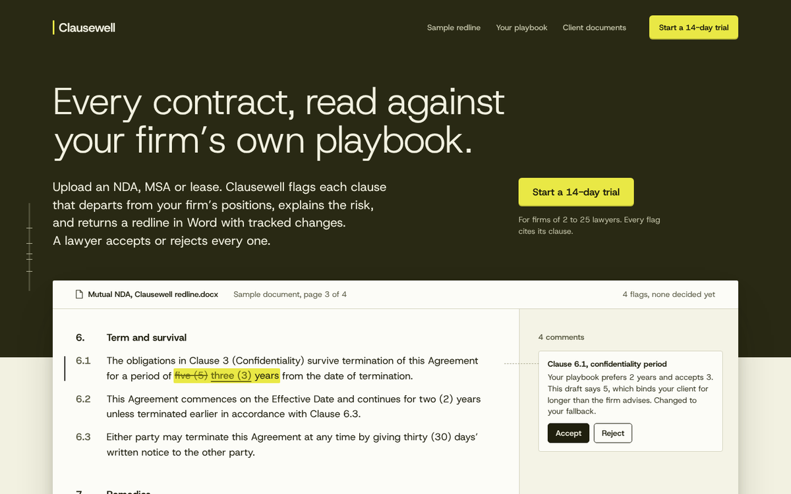
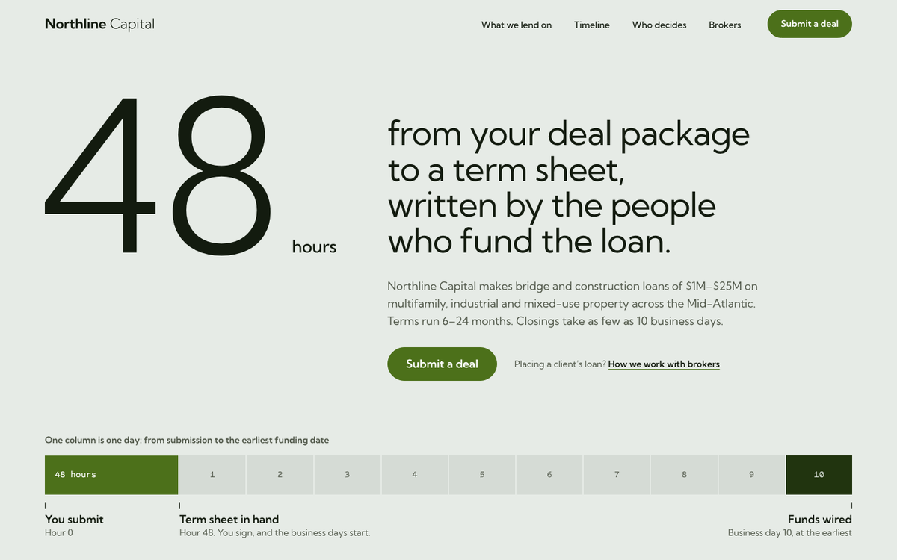

<p></p>

# Agency of One

**Thousand-dollar agency results from a Claude subscription.**

A Claude Code plugin that makes Claude design websites the way an exceptional agency would: business-forward, polished, cohesive, and built to stop looking AI-generated or templated.

Ask Claude Code for a landing page and you usually get the same page: centred hero, gradient headline, three icon cards. Ask it to "avoid AI slop" and you get the *second* AI look: cream and serif with a clay accent, ALL-CAPS eyebrows, `→` on every link. This plugin fixes that by changing the inputs Claude designs from, taking the riskiest choices away from it, and holding the result to a world-class finish standard.

## How it works
| Stage | What happens | Why it works |
|---|---|---|
| **Strategy** | Positioning, the one belief, competitor category codes (keep/break), brand idea, real proof inventory | Distinction comes from strategy, not decoration |
| **Draw** (`draw.mjs`) | Crypto-random levers: composition system, brand device, palette strategy, **brand hue sampled in OKLCH outside the default zones** (navy/indigo/violet/clay), type strategy, quality reference | Models collapse to the most likely look; randomness from outside the model breaks that (taste-skill's "deal, never choose") |
| **Two baselines** | Claude writes the *AI twin* and the *agency-cliché twin*, then must differ from both on every axis | Name the default to avoid it (Anthropic frontend-design, 2026) |
| **Five directions + independent critic** | A separate `direction-critic` agent scores typicality *and* strength; the script picks among the atypical **and** strong ones | Verbalized sampling widens range 1.6–2.1×; an independent scorer can't be gamed; the strength gate kills "unusual but drab" |
| **Hero set piece first** | The hero composition is built and polished in isolation before the page | Where agency work earns its first impression |
| **Craft finish pass** | `craft.md`: hand-set display type, grid audit, rhythm, colour harmony, art-directed slots, motion, states, responsive composition, copy edit, technical finish | The wow comes from everything coming together |
| **Lint on every edit** | 57-rule detector for gen-1–4 AI tells and agency clichés; findings fed straight back to Claude | Executable gates beat adjectives (Hallmark, Impeccable) |
| **Measure what rendered** | Screenshots (fold, mobile fold, scroll, states, reduced motion) + `render-report.json` + `plan-diff.mjs` | Agents leave >25% of stated design decisions unimplemented ("Design Theater", 2026) |
| **Blind two-axis review** | `design-reviewer` scores distinctiveness and 10 craft axes against named category benchmarks. SHIP needs every axis ≥ 8. Max 3 rounds, keep the best | External critics beat self-critique; unbounded self-revision degrades (ReLook) |
| **Memory** | `designlog.mjs` blocks reusing a display face or repeating a past project's fingerprint | Stops Claude converging on its own house style |

Two modes: **agency** (default; business-forward and polished) and **expressive** (`--mode expressive`; non-web reference media and constraints for campaigns, editorial, and experimental work).

## Blind-tested, not just claimed
The kit was built by running it end-to-end on real briefs with fresh agents and having **independent blind reviewers** judge the screenshots (they weren't told which pages used the kit). Same model, same brief:

| | AI-probability (neutral reviewer) | AI-probability (reviewer told to hunt for AI) | Agency-probability |
|---|---|---|---|
| **Without the kit** (control) | 65 | 88 | 25 |
| **With the kit** (3 business sites, after one review round) | 35–40 | 75–80 | 50–60 |

<table><tr>
<td width="50%"><br><sub><b>Without the kit.</b> "B2B consultancy template in the Webflow mould"</sub></td>
<td width="50%"><br><sub><b>With the kit.</b> Ranked #1 by both blind panels: the hero is the product doing its job</sub></td>
</tr><tr>
<td><br><sub>Commercial real-estate lender: one true figure and a day-by-day funding clock</sub></td>
<td><br><sub>Fractional CTO practice: a persistent "answerable for" column as the brand idea</sub></td>
</tr></table>

**What the reviewers still said**, and what the kit now does about it:
- *"No people, no photography, no proof caps credibility at ~6/10."* The kit now asks for real photos, bios, clients, and contact details **before** designing (the single biggest lever), and slots them professionally when they're missing.
- *"All of these share a hand: an honest-assistant voice, code-drawn imagery only, tinted off-white grounds."* That's a new fourth-generation tell (G4), now catalogued, linted (6 new rules), and countered in the voice and palette guidance.
- *"Good in-house or mid-tier studio work."* That's the honest current ceiling for code-only output. Real photography and proof are what take it further.

Example sites (static, unattended runs, all content from a one-paragraph brief) are in `examples/`.

## Install
### As a Claude Code plugin (recommended)
```text
/plugin marketplace add sam-pop/agency-of-one
/plugin install agency-of-one@agency-of-one
```
You get the skill, the `design-reviewer` and `direction-critic` agents, `/agency-of-one:design-review`, a lint-on-edit hook, and a SessionStart hook that loads the core rules into context in frontend repos (and stays silent in others).

### As a drop-in (copies into `.claude/`)
```bash
git clone https://github.com/sam-pop/agency-of-one
cd your-repo && ../agency-of-one/install.sh        # this repo
../agency-of-one/install.sh --global                # all projects (~/.claude)
```
This merges the hook into `.claude/settings.json` (never overwrites), adds the rules block to `CLAUDE.md` (idempotent), and gitignores `.design-review/`. Flags: `--target DIR`, `--no-hook`, `--no-claude-md`.

### Per project
```bash
npm i -D playwright && npx playwright install chromium     # screenshots + type specimens
```

## Use
Ask Claude Code for UI work as usual. The skill triggers on its own and the rules are always loaded.
- **New site:** Claude runs strategy → draw → 5 directions → critic → pick → `DESIGN.md` (commit it) → hero set piece → page → finish pass → verification loop.
- **Existing `DESIGN.md`:** Claude follows it exactly.
- **`/design-review [url] [routes]`:** lint + screenshots + plan-diff + blind review whenever you want.
- **Deliberate exceptions** (a brand font, a card-mandated grid): note them in `DESIGN.md §9` and `slop-lint.config.json`:
  ```json
  { "allowFonts": ["Fraunces"], "allowRules": ["eyebrow"], "ignore": ["legacy/**"] }
  ```
  Or add an inline `slop-ok: rule-id` comment.

## Tools (run from your repo root; `$S` = the skill folder)
| Command | Does |
|---|---|
| `node $S/scripts/draw.mjs --project "Name" [--mode expressive]` | Deal the levers (and brand hue) |
| `node $S/scripts/draw.mjs --pick "A:0.3:8,B:…"` | Pick among atypical + strong directions (scores from the critic) |
| `node $S/scripts/type-specimen.mjs --fonts "A, B, C" --text "…" --body "…"` | Render font candidates with your real copy |
| `node $S/scripts/slop-lint.mjs [--json]` | Detect tells (exit 1 on errors) |
| `node $S/scripts/screenshot.mjs --url URL [--state name=click:#sel]` | Render + measure |
| `node $S/scripts/plan-diff.mjs` | DESIGN.md tokens vs what rendered |
| `node $S/scripts/designlog.mjs check\|add\|list` | Cross-project memory |

## Repo layout
```
.claude-plugin/        plugin.json, marketplace.json
hooks/                 hooks.json (SessionStart rules + PostToolUse lint), rules.md, session-rules.mjs
skills/agency-of-one/
  SKILL.md
  references/          agency.md · craft.md · tells.md · typography.md · process-notes.md · decks.json
  templates/DESIGN.md
  scripts/             draw · type-specimen · slop-lint · hook-lint · screenshot · plan-diff · designlog
agents/                design-reviewer.md · direction-critic.md
commands/              design-review.md
install.sh             drop-in installer
tests/                 run.mjs + fixtures (npm test; CI on every push)
```
Zero runtime dependencies besides Playwright (screenshots only). Node 18+.

## Honest limits
- Lint is a floor; the critic, the craft pass, and the blind review are the real gates.
- Code can't produce photography. Real photos and client proof make the biggest difference; the kit turns missing ones into professional, art-directed slots instead of faking them.
- Tells evolve. When a new default shows up across your projects, add it to `tells.md` and `slop-lint.mjs` with a fixture. **Never add a recommended-fonts list:** whatever gets recommended becomes the next tell.
- If the brief or brand guide pins a look, the brief wins and the kit records the exception.

## Research basis
Anthropic frontend-design skill (June 2026 rewrite) · Hallmark gates · Impeccable · pixelslop · taste-skill · Refero anti-slop · Verbalized Sampling (arXiv 2510.01171) · Vibe Design Agents (Google, 2026) · ReLook (arXiv 2510.11498) · Design Creativity Bench (arXiv 2610.11539) · "Design Theater" (arXiv 2607.22928) · DesignArena 64k-page study. Full source list in `references/tells.md`.

## License
MIT © Sam P.
