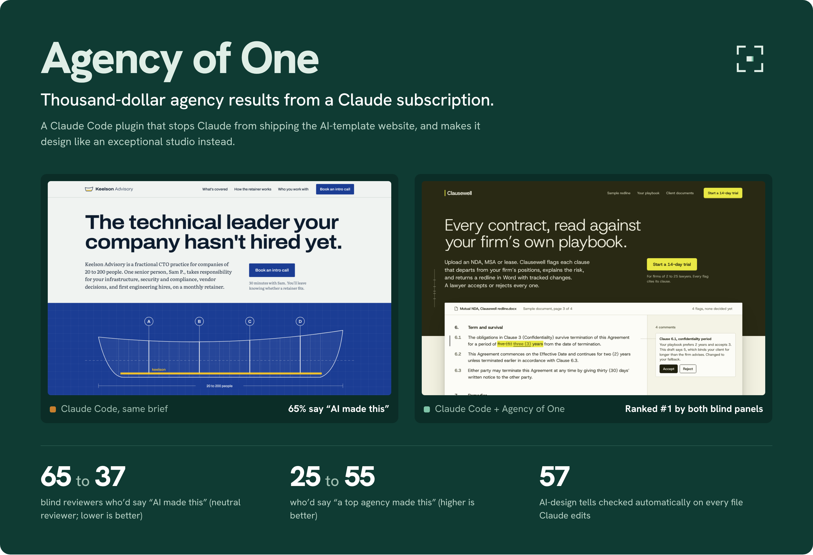
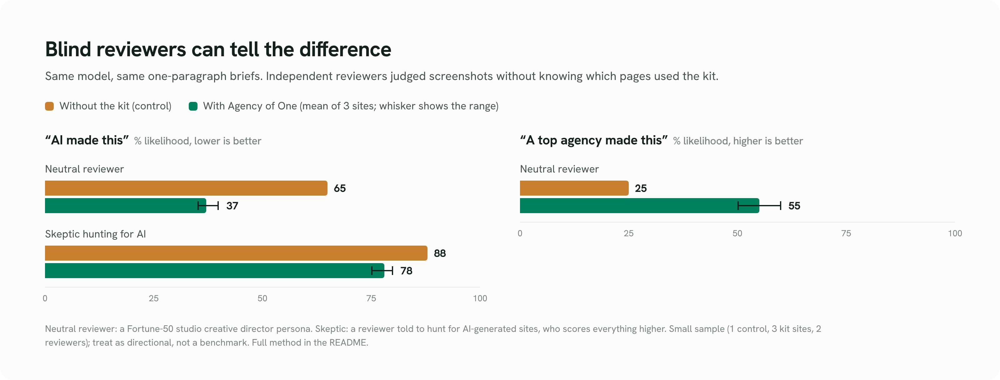
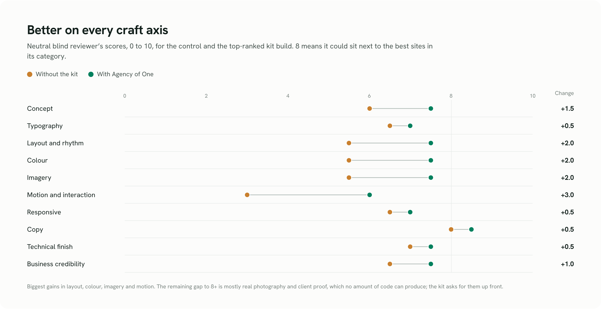
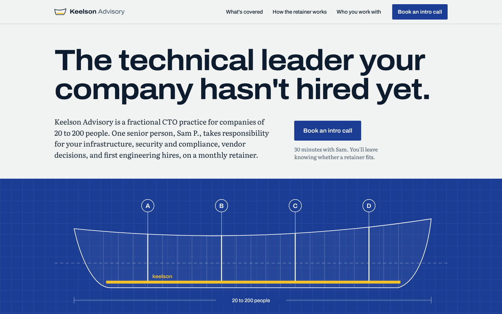
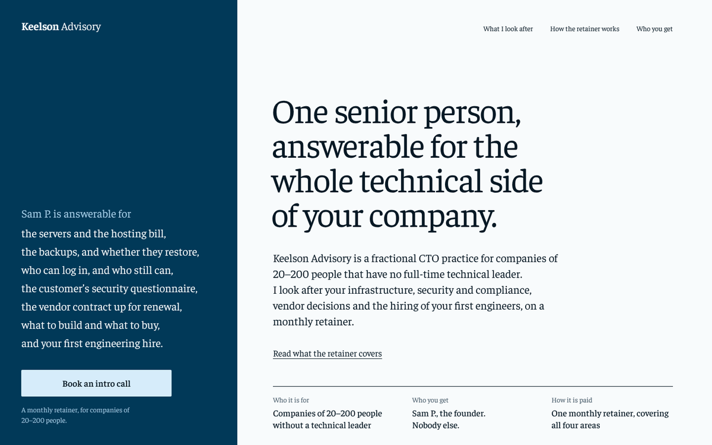
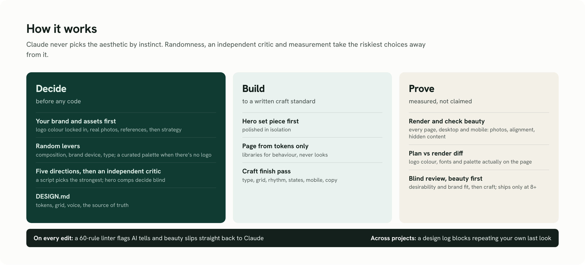

<p align="center"></p>

<p align="center">
<a href="#install"><b>Install</b></a>&nbsp;&nbsp;|&nbsp;&nbsp;<a href="#the-evidence"><b>Evidence</b></a>&nbsp;&nbsp;|&nbsp;&nbsp;<a href="#how-it-works"><b>How it works</b></a>&nbsp;&nbsp;|&nbsp;&nbsp;<a href="#whats-inside"><b>What’s inside</b></a>&nbsp;&nbsp;|&nbsp;&nbsp;<a href="#faq"><b>FAQ</b></a>
<br><br>


</p>

**Ask Claude Code for a website and you get the same website**: centred hero, gradient headline, three icon cards. Ask it to "avoid AI slop" and you get the second AI look: cream background, serif headline, clay accent, ALL-CAPS labels, `→` on every link. **Agency of One** fixes the inputs instead of adding rules. It gives Claude a studio’s process, takes the riskiest choices away from it, and won’t call the work done until a blind reviewer signs off.

## Install

### Tell your agent
Paste this into Claude Code:

```text
Install the Agency of One design plugin for me:
1. Run `claude plugin marketplace add sam-pop/agency-of-one`
2. Run `claude plugin install agency-of-one@agency-of-one`
3. In this project, run `npm i -D playwright && npx playwright install chromium` so you can screenshot your design work
4. Run `claude plugin details agency-of-one` and show me the result
Then tell me to restart Claude Code so the plugin loads.
```

### Or do it yourself
```text
/plugin marketplace add sam-pop/agency-of-one
/plugin install agency-of-one@agency-of-one
```
```bash
npm i -D playwright && npx playwright install chromium   # per project, for screenshots
```

<details>
<summary><b>No plugin system? Drop-in install</b> (copies into <code>.claude/</code>)</summary>

```bash
git clone https://github.com/sam-pop/agency-of-one
cd your-repo && ../agency-of-one/install.sh      # this repo only
../agency-of-one/install.sh --global              # every project (~/.claude)
```
This merges the lint hook into `.claude/settings.json` (never overwrites), adds the rules block to `CLAUDE.md` (idempotent), and gitignores `.design-review/`. Flags: `--target DIR`, `--no-hook`, `--no-claude-md`.
</details>

### Update
Tell your agent: *"Update the Agency of One plugin to the latest version."* Or run it yourself:
```bash
claude plugin marketplace update agency-of-one && claude plugin update agency-of-one@agency-of-one   # then restart Claude Code
```
Drop-in installs: `./update.sh` in your clone (`--global` / `--target DIR` as when installing). Your DESIGN.md, config and design log are never touched. Claude also tells you once a day, at most, when a new release exists (opt out: `AGENCY_OF_ONE_NO_UPDATE_CHECK=1`). Upgrading an older project: `/agency-of-one:upgrade-design`. Release notes: [CHANGELOG](CHANGELOG.md).

### Then just ask
```text
Build the homepage for Northline Capital, a private lender making $1M–$25M bridge loans
on commercial real estate in the Mid-Atlantic. Term sheet in 48 hours. Get brokers to submit a deal.
```
The skill triggers on its own. **For the best result, hand Claude your logo, real photos, bios, client names and contact details up front**, plus 2–3 sites you find beautiful (screenshots in `design-references/`). The palette is built from your brand's own colours. It’s the single biggest lever (see [the evidence](#the-evidence)).

---

## The evidence
We ran the kit end to end on real briefs with fresh agents, then had independent reviewers judge the screenshots **blind**: they weren’t told which pages used the kit. Same model, same one-paragraph briefs.

<p align="center"></p>

| | “AI made this” (neutral reviewer) | “AI made this” (skeptic hunting for AI) | “A top agency made this” |
|---|---:|---:|---:|
| Without the kit (control) | 65% | 88% | 25% |
| With Agency of One (mean of 3 sites) | **37%** (35–40) | **78%** (75–80) | **55%** (50–60) |

<p align="center"></p>

### v1.1 on a real client site
v1.0 passed the "doesn't look AI-made" test, but on a real nonprofit client site the result looked plain and off-brand: an olive palette fighting a blue crest, caps labels, centred text, mixed photo crops. v1.1 rebuilt the same three pages with the client's own assets. Three blind reviewers (a client stakeholder, an agency creative director and an AI-design skeptic) compared old and new without knowing which was which, and **all three picked the v1.1 rebuild**.

| Mean of 3 blind judges | Original (v1.0-era build) | v1.1 rebuild |
|---|---:|---:|
| Desirability (0–10) | 4.3 | **7.5** |
| Brand fit (0–10) | 2.8 | **8.8** |
| “AI made this” | 60% | **35%** |
| “A top agency made this” | 5% | **45%** |

What they still flagged (an invented seal, one hero reused on every page, people shown twice) became new rules (G5 in `tells.md`). Client pages aren't shown here.

### Same brief, before and after
<table>
<tr>
<td width="50%" valign="top"><br><sub><b>Without the kit.</b> One reviewer: “a B2B consultancy template in the Webflow mould.” Another, blind: “the one a design-literate viewer calls AI fastest.”</sub></td>
<td width="50%" valign="top"><br><sub><b>With the kit: Clausewell</b> (AI contract review). Ranked #1 by both blind panels. The hero is the product doing its job: a real, interactive redline.</sub></td>
</tr>
<tr>
<td valign="top"><br><sub><b>Northline Capital</b> (commercial lender). One true figure and a day-by-day funding clock. Reviewer: “a stranger gets the offer in five seconds.”</sub></td>
<td valign="top"><br><sub><b>Keelson Advisory</b> (fractional CTO). A persistent column turns the brand idea into structure. Reviewer: “holds its own on voice, colour discipline and typesetting.”</sub></td>
</tr>
</table>

All three were unattended runs from a one-paragraph brief, with no photos, no client proof and no human edits.

### What the reviewers still said, and what changed because of it
| Finding | What the kit does now |
|---|---|
| “No people, no photography, no proof”: credibility and imagery stall around 6/10 | Asks for real photos, bios, clients and contact details **before** designing; slots them professionally when missing, never fakes them |
| “These share a hand”: an honest-assistant voice, code-drawn imagery only, tinted off-white grounds | Catalogued as a 4th-generation tell (G4), with 6 new lint rules and revised voice and palette guidance |
| “Good in-house or mid-tier studio work” | The honest ceiling for code-only output today. Real photography and proof are what lift it further |

<details>
<summary><b>Method, in full</b></summary>

- **Builds:** fresh Claude agents with no conversation context ran the plugin unattended on three briefs (fractional CTO practice, AI contract-review SaaS, commercial real-estate lender) and did one fix round from the kit’s own reviewer. The control was the same model given the CTO brief with “make it look great” and no kit.
- **Panels:** two independent reviewer agents saw five pages under shuffled letters (three kit builds, the control, and an earlier expressive-mode build). One was a neutral “Fortune-50 studio creative director”; the other was told to hunt for AI-generated sites. Neither knew a kit existed.
- **Scores:** “AI made this” and “a top agency made this” are 0–100 likelihoods; craft axes are 0–10, where 8 means it could sit next to the best sites in its category.
- **Caveats:** small sample (one control, three kit sites, two reviewers); reviewers are models, not people. Treat the numbers as directional evidence, not a benchmark. The full transcripts informed every rule in `references/tells.md`.
</details>

---

## How it works
<p align="center"></p>

Models collapse to the most likely design. Banning that look only moves them to the *next* most likely one, which is how the cream-and-serif look became the second AI tell. So the kit doesn’t ask Claude to be creative. It changes what Claude designs **from**:

| Mechanism | What it does | Why it works |
|---|---|---|
| **Strategy first** | Positioning, the one belief, 5 competitor “category codes” marked keep or break, real proof inventory | Distinction comes from strategy, not decoration |
| **Brand-first colour** | `brand-extract.mjs` takes the brand colour straight from your logo, and from then on the palette is locked to it (plan-diff fails any palette that loses it); new brands draw from a **curated library of 22 contrast-checked palettes**, never random hues | A palette that fights the logo is the fastest way to look amateur |
| **Random levers** | A script deals a composition system, brand device, palette strategy, type strategy and quality reference: **~8.7 million combinations** | Randomness from outside the model breaks mode collapse |
| **Two baselines** | Claude writes the *AI twin* and the *agency-cliché twin* of the brief, then must differ from both on every axis | Name the default to avoid it |
| **Independent critic** | Five directions go to a separate agent that scores typicality and strength; a script picks at random among the atypical **and** strong ones | Verbalized sampling widens range 1.6–2.1×; a separate scorer can’t be gamed; the strength gate kills “unusual but drab” |
| **Hero first, then finish** | The hero is built and polished in isolation, then the page, then a line-by-line craft pass | Where agency work earns its first impression |
| **Lint on every edit** | 60 detectors for 4 generations of AI tells and agency clichés; findings go straight back to Claude | Executable gates beat adjectives |
| **Measure the render** | Screenshots at 1440/390 plus states and scroll positions; which fonts *actually* loaded; colour and size distribution | Agents leave >25% of stated design decisions unimplemented |
| **Beauty checks** | Render-time checks for content left invisible by animations, initials avatars, inconsistent photos, centred paragraphs, caps headings, divider bars, and photos clashing with the palette | The failures that make a site look cheap, caught by measurement |
| **Blind review, desirability first** | Beauty and brand fit first, then 10 craft axes and distinctiveness, against named benchmarks and your reference sites; SHIP needs ≥ 8 everywhere; max 3 rounds, keep the best | Not looking AI-made is necessary but not sufficient |
| **Memory** | A design log blocks reusing a display face, or repeating a past project on more than 3 of 6 axes | Stops Claude converging on its own house style |

Two modes: **agency** (default; business-forward and polished) and **expressive** (`--mode expressive`; non-web reference media and constraints for campaigns, editorial and experimental work).

---

## What’s inside
| Component | What it is | Token cost* |
|---|---|---|
| `agency-of-one` skill | The 4-phase process plus 5 reference files | ~130 always-on, ~2.3k when it runs |
| `design-reviewer` agent | Blind ECD: two-axis scoring, fixed verdict rules | ~100 always-on, ~1.1k per review |
| `direction-critic` agent | Scores directions for typicality and strength | ~100 always-on, ~490 per run |
| `/agency-of-one:design-review` | Lint, screenshots, plan-diff and blind review in one command | ~30 always-on, ~370 per run |
| `/agency-of-one:upgrade-design` | Brings an older DESIGN.md up to brand-first colour and beauty rules | small, per run |
| SessionStart hook | Loads the core rules, **only in frontend repos** | ~680 in those repos, 0 elsewhere |
| PostToolUse hook | Runs the linter on every edited UI file | none (harness-side) |

<sub>*From `claude plugin details`: about **366 tokens always-on**. A full run (five directions, critic, build, up to three reviews) is token-heavy; budget for it like a real design engagement.</sub>

**Scripts** (zero runtime dependencies besides Playwright; Node 18+; run from your repo root, `$S` = the skill folder):

| Command | Does |
|---|---|
| `node $S/scripts/brand-extract.mjs [files…]` | Brand colour and palette from your logo (auto-discovers) |
| `node $S/scripts/photo-normalise.mjs <dir> --ratio 4:5 --backdrop "#hex"` | One crop and backdrop for every people photo |
| `node $S/scripts/draw.mjs --project "Name" [--no-brand "reason"] [--mode expressive]` | Deal the levers; colour brand-locked automatically, or from the curated library |
| `node $S/scripts/draw.mjs --pick "A:0.3:8,B:…"` | Pick among atypical and strong directions (scores from the critic) |
| `node $S/scripts/type-specimen.mjs --fonts "A, B, C" --text "…"` | Render font candidates with your real copy, then choose by looking |
| `node $S/scripts/slop-lint.mjs [--json]` | Detect tells (exit 1 on errors) |
| `node $S/scripts/screenshot.mjs --url URL [--widths 1024,768] [--state name=click:#sel]` | Render, capture, measure |
| `node $S/scripts/plan-diff.mjs` | DESIGN.md tokens vs what actually rendered |
| `node $S/scripts/designlog.mjs check\|add\|list` | Cross-project memory |
| `node $S/scripts/update-check.mjs --force` | Check for a newer release |

<details>
<summary><b>What the linter catches</b> (61 rules, 4 generations)</summary>

| Generation | Examples |
|---|---|
| **G1**, the original AI look | Inter/Roboto/system fonts, purple and indigo, gradient text, glows and glass, blurred blobs, three icon cards, “Trusted by” logo strips, emoji headings, ✨, buzzword copy, invented stats, generic CTAs | <!-- slop-ok -->
| **G2**, “tasteful AI” | Fraunces/Instrument Serif/Space Grotesk/Geist and friends, cream `#F4F1EA` + clay `#D97757`, near-black + acid accent, ALL-CAPS eyebrows, `A · B · C` meta, `→` on links, one italic word in a headline, 01/02/03, untouched shadcn theme | <!-- slop-ok -->
| **G3**, the anti-slop house style | The page built as a paper artefact, hairline cells, lettered keys, mono annotations, neobrutalist offset shadows, marquee strips | <!-- slop-ok -->
| **Beauty** (v1.1), what makes a site look cheap | ALL-CAPS headings and labels, centred body copy, short decorative divider bars, initials placeholder avatars, invented seals; at render time (desktop and 390px): centred text blocks, content hidden by animations or without JS, inconsistent photo crops and backdrops, missing page headers, a palette that loses the logo colour |
| **G4**, the honest-assistant fingerprint | “Nobody else.” / “What X is not” voice, narrated demos, “Question N of 5”, the same CTA five times, straight apostrophes |

Full catalog with signatures and sources: [`references/tells.md`](skills/agency-of-one/references/tells.md).
</details>

### Configure
- **Your brand wins.** If the brief or a brand guide pins a look, Claude follows it and records the exceptions.
- **Existing `DESIGN.md`** at the repo root is followed exactly, so commit it.
- **Deliberate exceptions** go in `DESIGN.md §9` and `slop-lint.config.json`:
  ```json
  { "allowFonts": ["Fraunces"], "allowRules": ["eyebrow"], "ignore": ["legacy/**"] }
  ```
  Or add an inline `slop-ok: rule-id` comment.

---

## FAQ
**Does it work on a $20 Pro plan?** It installs and runs, but a full run (five directions, critic, build, up to three blind reviews) is token-heavy, so expect to hit usage limits on Pro. It’s comfortable on Max. The always-on cost is ~366 tokens.

**Will every site I build look the same?** That’s what the design log is for. It blocks reusing a display face from your last six projects or repeating a past project’s fingerprint, and the levers (and the palette, when there's no logo to lock it to) are dealt with real randomness.

**Next.js / Tailwind / shadcn?** Yes. Tokens go in CSS variables or Tailwind v4 `@theme`, and shadcn/Radix are used for behaviour only, with every primitive restyled.

**Can I use it on an existing site?** Yes. Run `/agency-of-one:design-review` for a blind review and lint report on what you have, or ask Claude to write a `DESIGN.md` for it first.

**Why does it ask for photos and client names?** Because the blind reviewers scored credibility and imagery around 6/10 without them, whatever the design quality. Code can’t produce proof.

**Is a lint pass enough?** No. Lint is the floor. The critic, the craft pass and the blind review are the real gates.

---

## Contributing
Spotted a new default creeping into AI-built sites? Add it to `references/tells.md` with its signature and generation, add a detector to `scripts/slop-lint.mjs`, add a case to `tests/fixtures/slop`, and check that `tests/fixtures/clean` stays clean. `npm test` runs the self-tests, and CI runs them on every push. **Never add a recommended-fonts list:** whatever gets recommended becomes the next tell.

## Research basis
Anthropic’s frontend-design skill (June 2026 rewrite); the Hallmark, Impeccable, pixelslop, taste-skill and Refero anti-slop projects; Verbalized Sampling (arXiv 2510.01171); Vibe Design Agents (Google, 2026); ReLook (arXiv 2510.11498); Design Creativity Bench (arXiv 2610.11539); “Design Theater” (arXiv 2607.22928); the DesignArena 64k-page study. Sources in [`references/tells.md`](skills/agency-of-one/references/tells.md).

## License
MIT © Sam P.
